# Final Project: OHIE Medicaid Policy Simulation

**Project Name:** Allocating Scarce Medicaid Coverage: A Counterfactual Comparison of Lottery, Need-Based, and Learned Targeting in the Oregon Health Insurance Experiment

**Google Colab:** https://colab.research.google.com/drive/1u5X3mlRkt91kVgizIwHFNViJZg_sELED?usp=sharing

**Author:** Chayce Reed

**Date:** 10/18/26

## Purpose

This notebook asks how a fixed number of Medicaid offers should be allocated, using the Oregon Health Insurance Experiment (OHIE) Public Use Data. It covers data selection, cleaning, and exploration, followed by supervised machine learning classification, causal inference, heterogeneity analysis, and a policy simulation.

The classification section trains and compares three classifiers (logistic regression, random forest, XGBoost) for predicting medical debt at 12 months, using household-grouped cross-validation, hyperparameter tuning, and out-of-fold evaluation. The causal section estimates the effect of a lottery offer (ITT, via weighted OLS, g-computation, and AIPW) and of Medicaid enrollment among compliers (LATE, via 2SLS) on four financial strain outcomes. The heterogeneity section fits a cross-fitted causal forest and tests whether the effect varies across subgroups, using a calibration test and prespecified subgroups. The policy simulation holds the number of offers fixed at the lottery's budget adn comapres five allocation rules (lottery, need-based, risk-based, benefit-based, universal) on how much medical debt each would avert, with doubly robust evaluation, a household bootstrap, and a sweep across budget levels.

## Data Source & Provenance

**Data Source:** Oregon Health Insurance Experiment (OHIE) Public Use Dataset

**Data Access:** https://www.nber.org/research/data/oregon-health-insurance-experiment-data (Free registration, if prompted)

**Data Description:** "In 2008, a group of uninsured low-income adults in Oregon was selected by lottery to be given the chance to apply for Medicaid. This lottery provides a unique opportunity to gauge the effects of expanding access to public health insurance on the health care use, financial strain, and health of low-income adults using a randomized controlled design. The Oregon Health Insurance Experiment followed and compared those selected in the lottery (treatments) with those not selected (controls)."

**Data Files:** The dataset includes six separate datasets from the OHIE that have been made publicly available. For this project, the following datasets will be used: Descriptive Variables (oregonhie_descriptive_vars.dta), State Program Variables (oregonhie_stateprograms_vars.dta), and Twelve Month Mail Survey (oregonhie_survey12m_vars.dta).

**Data Selection:** The OHIE dataset was selected for this project because it provides a unique opportunity to analyze the effects of Medicaid coverage on low-income adults in Oregon. The experiment's randomized "lottery" design allows for the comparison between those who were selected for Medicaid coverage and those who were not, making it a useful dataset for studying the impact of health insurance on various outcomes. This dataset also lines up directly with my research interests and goals. I am applying to PhD programs to study causal inference for health services, policy, and equity research, across two key areas: how health policy and health care delivery systems shape access for marginalized populations, and how automated decision-making produces and entrenches disparities in health care. This dataset and project fits squarely into the former, and will allow me to investigate how coverage decisions affect low-income, uninsured populations and how those decisions could be made more equitably. The data includes characteristics recorded before the lottery, which makes it possible to estimate the causal effect of a coverage offer, test whether the effect differs across subgroups, and simulate whether an alternative allocation rule (e.g., need-based, learned-targeting) would have prevented more medical debt than the lottery. This combination of causal inference, policy simulation, and equity analysis is the kind of work I am hoping to develop my future PhD research agenda around, which makes it a very exciting dataset and project to work on.

**Binary Classification:** Yes. The target whether the respondent owes money for medical expenses at 12 months (binary: 1 = yes, 0 = no).

**Observation Count:** 23,741 respondents to the 12-month survey, out of 74,922 total people on the original lottery list.

**Predictor Variable Count:** 15 predictor variables measured before the lottery, including: age, sex, english-language preference, self-signup, phone number provided, PO box addressed used, metro-area zip, signup week, first-day signup, last-day signup, prior SNAP participant, prior TANF participant, household SNAP dollars, household TANF dollars, and any-state program indicator.

**Acknowledgements:** The project uses the public-use data from the Oregon Health Insurance Experiment, made available by the National Bureau of Economic Research (NBER). Finkelstein, Amy. Oregon Health Insurance Experiment Public Use Data, 2013. Available at https://www.nber.org/research/data/oregon-health-insurance-experiment-data.

## Visual Summary

### Data Exploration

| Outcomes by lottery status | Spearman correlation |
|:---:|:---:|
| 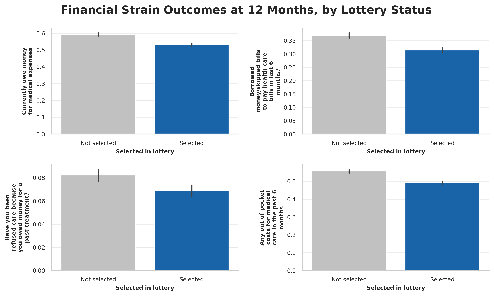 | 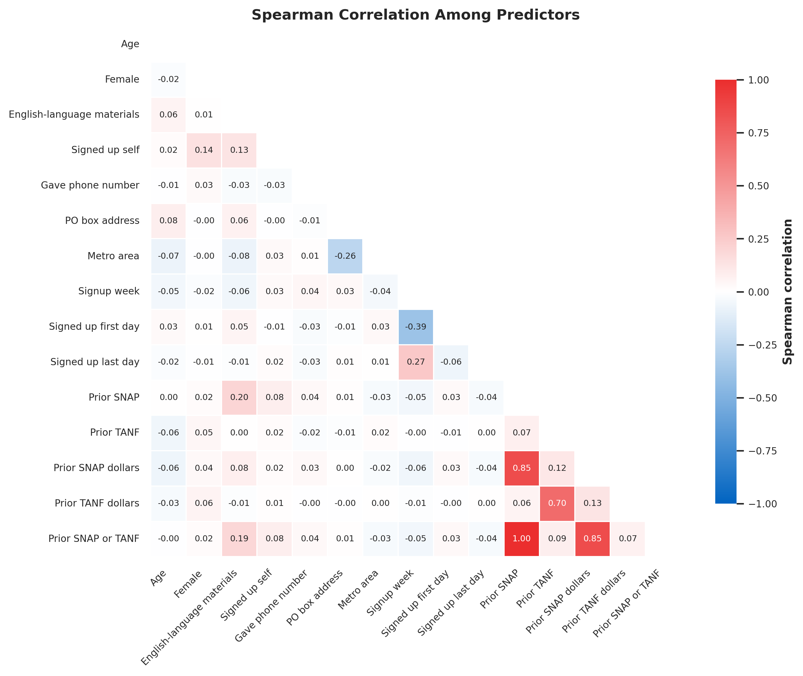 |

### Supervised Learning

| ROC curves | Calibration curves | Permutation importance |
|:---:|:---:|:---:|
| 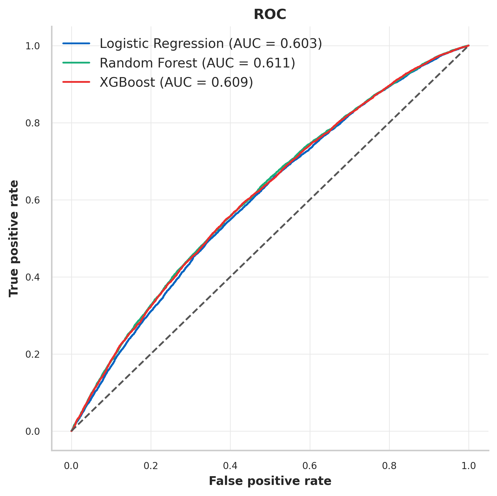 | 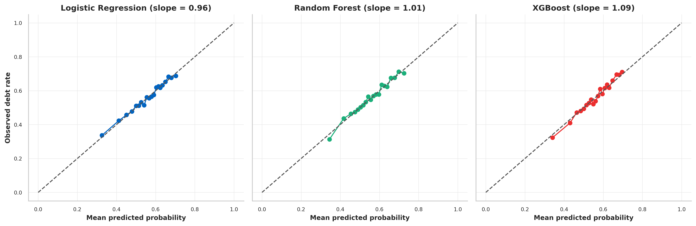 | 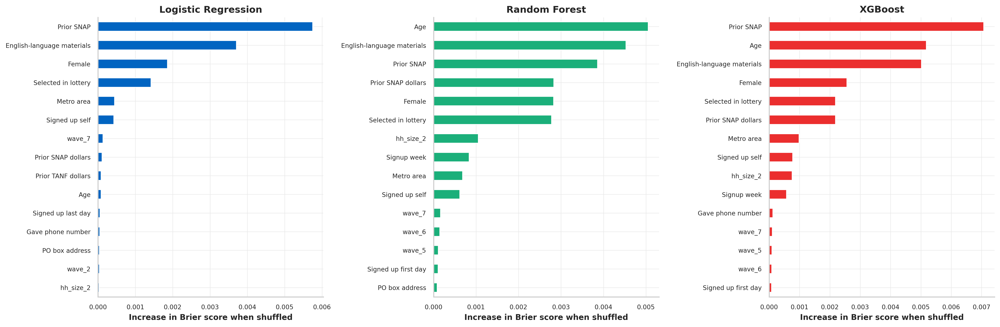 |

### Causal Inference

| Effect of lottery selection by outcome and estimator | LATE: 2SLS |
|:---:|:---:|
| 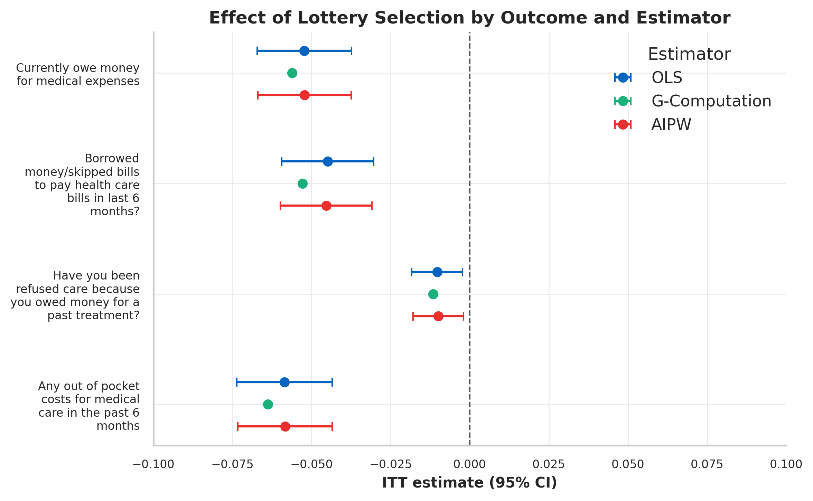 | 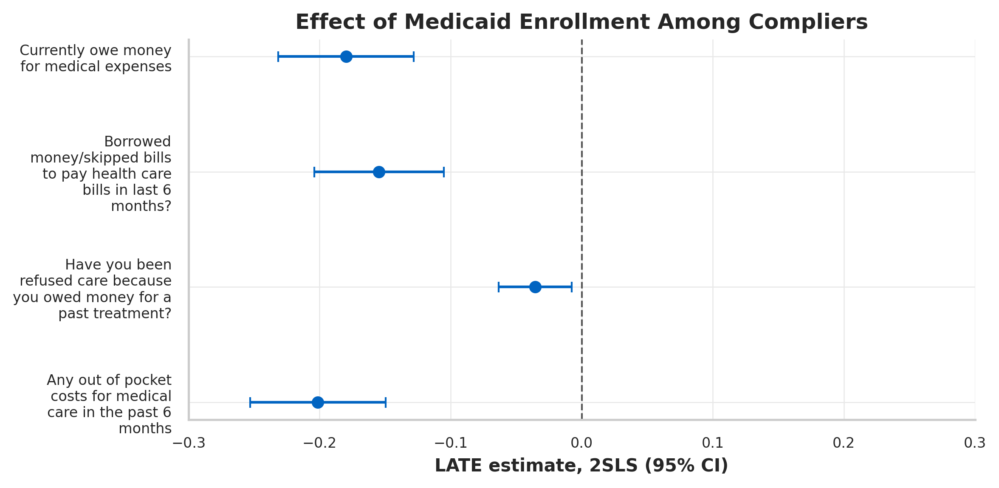 |

### Heterogeneity

| Forest prediction vs actual effect by quintile | Effect by prespecified subgroup | CATE surface |
|:---:|:---:|:---:|
| 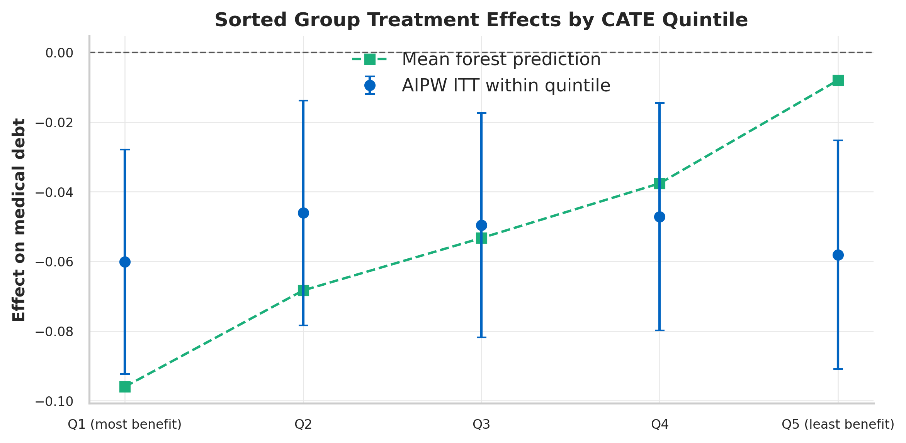 | 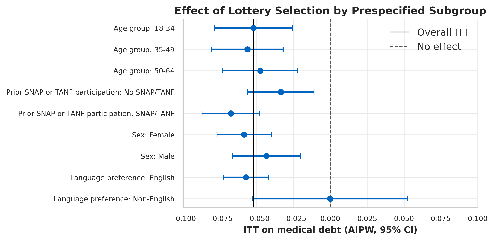 | 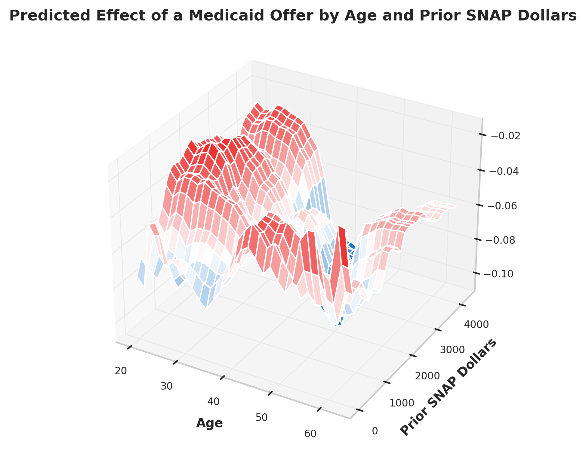 |

### Policy Simulation

| Debt averted across budgets | Who receives offers under each allocation rule |
|:---:|:---:|
| 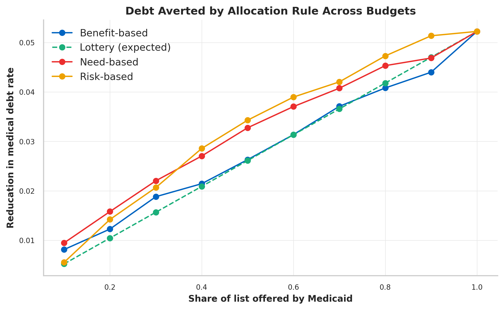 | 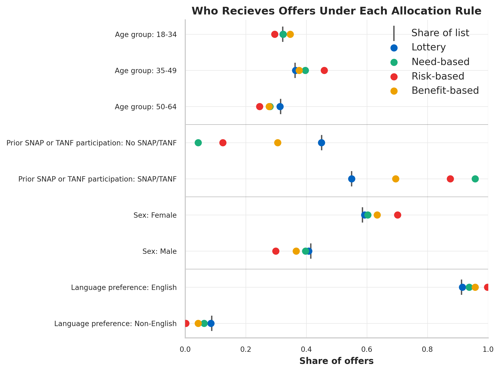 |

**Preprocessing Steps:**

- Merged the three datasets (descriptive, state program, and 12-month survey) into a single dataset for analysis.
- Restricted dataset to the 23,741 respondents who completed the 12-month survey.
- Renamed variables to shorter, more interpretable names and built a label dictionary mapping each to its readable description for tables and plots.
- Converted object-type columns to the appropriate numeric or categorical type, and cast binary outcomes as nullable integers to preserve missingness.
- Derived age from birth year and the 2008 survey year, grouped age into bands for the subgroup analysis, and created indicators for female, English-language preference, and any prior SNAP / TANF participation.
- Ran automated data quality checks (missingness, expected data types, validity rules on value ranges, unique person ID) that print pass/fail result for each, so any problem is visible in the output before modeling.
- Dropped any_program_pre from the predictor set, since it is nearly identical to snap_pre (Spearman correlation 0.999) and would add no additional information.
- One-hot encoded household size and survey wave, and standardized continuous predictors inside the logistic regression pipeline.
- Applied survey weights to descriptive statistics and causal estimates, and clustered standard errors by household.

**Challenges with the Dataset & How They Were Handled:**

- Offers vs coverage: Winning the lottery gave people the chance to apply for Medicaid coverage, but doesn't guarentee they were enrolled. This means that the treatment group (selected in the lottery) may include people who were not actually covered by Medicaid. To address this challenge, the primary analysis estimates intention-to-treat effect of an offer, and a secondary 2SLS analysis uses the lottery as an instrument to estimate the effect of enrollment among compliers.
- Survey non-response: Only 23,741 of the 74,922 people on the original lottery list completed the 12-month survey. Respondents may differ systematically from non-respondents, so the survey weights provided with the data were applied to all estimates to keep them representative of the full lottery list.
- Unequal selection probability: Households with more members had more lottery draws, and the survey fielded in waves tied to eight drawings, so the offer rate varied from 0.35 to 0.92 across household-size by wave cells. All causal models condition on household size by wave fixed effects, and within-cell offer rate serves as the known propensity score for AIPW.
- Household clustering: Selection was at the household level and household members share outcomes, so cross-validation folds were grouped by household to prevent leakage and all standard errors were clustered by household.

## Project Stages

**Data Preparation:** 

- Load the three OHIE State files (descriptive, state programs, 12-month survey), merge on person ID, and restrict to 12-month survey respondents. 
- Rename variables, derive age, age group, and prior SNAP/TANF indicators.
- Check for missingness, implausible values, and duplicate IDs, and verify the lottery selection is balanced across design strata.

**Outcomes:** 

- The primary outcome is medical_debt, defined as "Currently owe money for medical expenses" at the 12 month follow-up survey. 
- Three secondary outcomes capture related financial strain: cost_borrow_12m, cost_refused_12m, and cost_any_oop_12m, which represent "Borrowed money/skipped bills to pay health care bills in last 6 months?", "Have you been refused care because you owed money for a past treatment?", "Any out of pocket costs for medical care in the past 6 months", respectively. All four outcomes are binary (binary: 1 = yes, 0 = no). 
- Unweighted rates in the full sample are approximately 55% of all respondents reported having medical debt, 34% reported borrowing money or skipping bills to pay health care bills, 7% reported being refused care due to medical debt, and 52% reported out of pocket costs for medical care in the last 6 months. Survey-weighted rates in the control arm are 60%, 37%, 8%, and 56%, respectively.

**Prediction:** 

- Binary classification: predict whether a low-income, uninsured adult will owe money for medical expenses 12 months after applying for Medicaid, and which variables are the most predictive of that outcome.
- Inputs are characteristics recorded at signup (e.g., age, sex, language preference, prior state program participation, etc), plus whether the person was selected in the lottery.
- Logistic regression, random forest, and XGBoost are tuned by household-grouped cross-validation.
- Compared on out-of-fold performance on the following criteria:
  - AUC: how well each model discriminates between those who owe money for medical expenses and those who do not.
  - Brier Score: how well each model predicts the probability of owing money for medical expenses.
  - Calibration curves: how closely predicted probabilities match observed outcome rates.
  - Sensitivity: the share of respondents with medical debt the model flags (the priority metric since missing someone with debt is the costlier error)
- Variable importance is assessed by standardized coefficients, permuation importance, and SHAP. 
- The classifier's out-of-fold predictions will then be fed into the risk-based allocation rule in the policy simulation stage.

**Causal Inference:** 

- Estimate the effect of a Medicaid offer (intention-to-treat) on each outcome by weighted OLS with fixed effects.
  - Replication check: the ITT is compared against the published OHIE estimates before any downstream analysis builds on it.
- Estimate the effect of enrollment among compliers (LATE) by 2SLS with the lottery as the instrument. 
- Replicate the ITT with g-computation and AIPW to confirm the result agrees across estimators. 
- All models use survey weights and household-clustered standard errors.

**Heterogeneity:** 

- Fit a cross-fitted causal forest to estimate individual treatment effects.
- Test whether the predicted heterogeneity is real using a calibration test and sorted-group effects against the AIPW scores. 
- Estimate prespecified subgroup effects by age group, sex, language preference, and prior SNAP/TANF participation.

**Policy Simulation:** 

- Fix the budget at the lottery's offer count, so every rule hands out the same number of offers (with the exception of universal coverage), and compare five allocation rules:
  - Lottery: random allocation, reproducing the original OHIE design.
  - Need-based: offers ranked by prior SNAP / TANF dollars
  - Risk-based: offers ranked by predicted probability of medical debt without coverage, from the XGBoost classifier.
  - Benefit-based: offers ranked by the causal forest's predicted individual treatment effect.
  - Universal: no budget, everyone offered coverage
- Evaluate each with the doubly robust scores and cross-check with g-computation.
- Bootstrap by household for uncertainty in each rule's gain over the lottery
- Budget sweep from 10% to 90%.

**Summary:** 
- Report main results, limitations, and conclusions.

## Notebook Structure

- **1. Setup**
  - 1.1. Package Version Check & Installation
  - 1.2. Package Importing & Seed Setting
  - 1.3. File Path Creation & Locating Data
  - 1.4. Visualization Palette & Theme
- **2. Data Loading & Merging**
  - 2.1. Data Loading
  - 2.2. Data Subsetting & Merging
  - 2.3. Variable Renaming & Labeling
  - 2.4. Derived Variables
  - 2.5. Data Subsetting & Variable Grouping
- **3. Data Structure & Loading**
  - 3.1. Data Structure, Type, & View
- **4. Data Checks & Cleaning**
  - 4.1. Data Checks Functions
  - 4.2. Data Checks
  - 4.3. Data Cleaning
- **5. Data Exploration & Visualization**
  - 5.1. Summary & Visualization Functions
  - 5.2. Descriptive Statistics
  - 5.3. Treatment Group Comparisons
  - 5.4. Distribution Visualizations
  - 5.5. Outcomes by Treatment Groups
  - 5.6. Subgroup Analysis
  - 5.7. Predictor Correlation Matrix & Heatmap
- **6. Supervised Machine Learning Classification**
  - 6.1. Design Matrix & Cross-Validation Folds
  - 6.2. Logistic Regression
  - 6.3. Random Forest
  - 6.4. XGBoost
  - 6.5. Out-of-Fold Predictions
  - 6.6. Threshold Selection
  - 6.7. Performance Metrics & Overfit Check
  - 6.8. ROC & Calibration Curves
  - 6.9. Confusion Matrices
  - 6.10. Variable Importance
- **7. Causal Inference**
  - 7.1. Propensity Scores
  - 7.2. Covariate Balance Check
  - 7.3. Intention-to-Treat (ITT): OLS
  - 7.4. Local Average Treatment Effect (LATE): 2SLS
  - 7.5. G-Computation
  - 7.6. AIPW
  - 7.7. Summary of Causal Estimates
- **8. Heterogeneity & Subgroup Analysis**
  - 8.1. Causal Forest
  - 8.2. CATE Distribution
  - 8.3. Calibration Test & GATES
  - 8.4. Subgroups Analysis: Age Group, Sex, Language, Prior SNAP/TANF
  - 8.5. Forest Feature Importance
- **9. Policy Simulation**
  - 9.1. Determine Fixed Budget
  - 9.2. Allocation Rules: Lottery, Need-Based, Risk-Based, Universal
  - 9.3. Doubly Robust Evaluation of Each Rule using AIPW
  - 9.4. G-Computation Cross-Check
  - 9.5. Household Bootstrap for Uncertainty Estimation
  - 9.6. Budget Sweep & Summary 
  - 9.7. Subgroup Analysis of Allocation Rules
- **10. Summary & Limitations**
  - 10.1. Results
  - 10.2. Assumptions
  - 10.2. Limitations
  - 10.3. Conclusions

## Repo Structure

```
Final Project/
├── README.md
├── ohie_medicaid_policy_simulation_final_project.ipynb
└── outputs/
    ├── distribution_predictors.png
    ├── distribution_outcomes.png
    ├── distribution_outcome_by_treatment.png
    ├── distribution_outcome_by_treatment_and_subgroup.png
    ├── correlation_heatmap.png
    ├── threshold_selection.png
    ├── roc.png
    ├── calibration_curve.png
    ├── confusion_matrix.png
    ├── logistic_coefficient.png
    ├── permutation_importance.png
    ├── shap.png
    ├── itt.png
    ├── late.png
    ├── cate_distribution.png
    ├── cate_surface.png
    ├── cate_calibration.png
    ├── itt_subgroup_analysis.png
    ├── causal_forest_features.png
    ├── allocation_rule_at_50.png
    ├── allocation_rule_across_budgets.png
    └── offer_subgroup_composition.png
```

## Required Software & Libraries

Google Colab. Package versions are defined in and installed by the notebook.

| | Version |
|---|---|
| `Python` | 3.13.16 (CPython, Colab runtime) |
| `pandas` | 2.2.3 |
| `numpy` | 2.1.3 |
| `scipy` | 1.16.3 |
| `matplotlib` | 3.10.0 |
| `seaborn` | 0.13.2 |
| `scikit-learn` | 1.6.1 |
| `statsmodels` | 0.15.0 |
| `pyreadstat` | 1.3.6 |
| `xgboost` | 3.4.1 |
| `linearmodels` | 7.0 |
| `econml` | 0.17.0 |
| `shap` | 0.52.0 |

Standard libraries (`sys`, `platform`, `subprocess`, `zipfile`, `operator`, `pathlib`, `importlib.metadata`) are bundled with Python and are not installed separately.

## Instructions for Setup & Execution of Notebook

1. Open the notebook in Google Colab.
2. Download the OHIE public-use data from NBER: https://www.nber.org/research/data/oregon-health-insurance-experiment-data. Registration is free. The file is `oregon_puf.zip`.
3. Run the notebook using `Run all`. The setup step will automatically install required packages. When the data location step runs, a "Choose Files" button appears below the cell; click it and select `oregon_puf.zip`. Alternatively, drag the zip into the Files panel (folder icon, left sidebar) before running, and the notebook will find automatically. The notebook will unzip the zip file and locate the appropriate `.dta` files automatically.

Note: When running this notebook in Google Colab, the random forest and XGBoost hyperparameter tuning may take several minutes to complete. It takes approximately 15 minutes for the notebook to run end-to-end.

## Computational Environment Information

Google Colab:

```
Python implementation: CPython
Python version       : 3.13.16
IPython version      : 7.34.0

numpy       : 2.1.3
pandas      : 2.2.3
sklearn     : 1.6.1
xgboost     : 3.4.1
statsmodels : 0.15.0
linearmodels: 7.0
econml      : 0.17.0
shap        : 0.52.0
matplotlib  : 3.10.0
seaborn     : 0.13.2
pyreadstat  : 1.3.6

Compiler    : GCC 13.3.0
OS          : Linux
Release     : 6.6.122+
Machine     : x86_64
Processor   : x86_64
CPU cores   : 2
Architecture: 64bit
```

## AI Use Statement

Generative AI (Claude) was used as a coding, learning, and editing assistant for the following:

- Python syntax and package questions, such as reading Stata with pyreadstat, household-grouped cross-validation with GroupKFold, fitting 2SLS with linearmodels, and fitting causal forest with EconML.
- Brainstorming, implementing, and understanding supervised machine learning models (logistic regression, random forest, XGBoost), including hyperparameter tuning, threshold selection, calibration, variable importance (permutation importance, SHAP), and interpreting results.
- Brainstorming, implementing, and understanding causal inference methods (ITT via OLS, LATE via 2SLS, g-computation, AIPW), including design-based propensity score, survey weighting, household-clusters, and interpreting results.
- Brainstorming, implementing, and understanding heterogeneity analysis, including the cross-fitted causal forest, the calibration test and sorted-group effects, and subgroup analysis from AIPW scores.
- Explaining the methods and mathematical notation for the propensity score, intention-to-treat regression, two-stage least squares, g-computation, AIPW, and causal forest.
- Brainstorming and editing notebook and README structure / contents, and learning reproducibility and automation best practices.


I verified and reviewed all work. I take full responsibility for the accuracy and legitimacy of all work submitted.